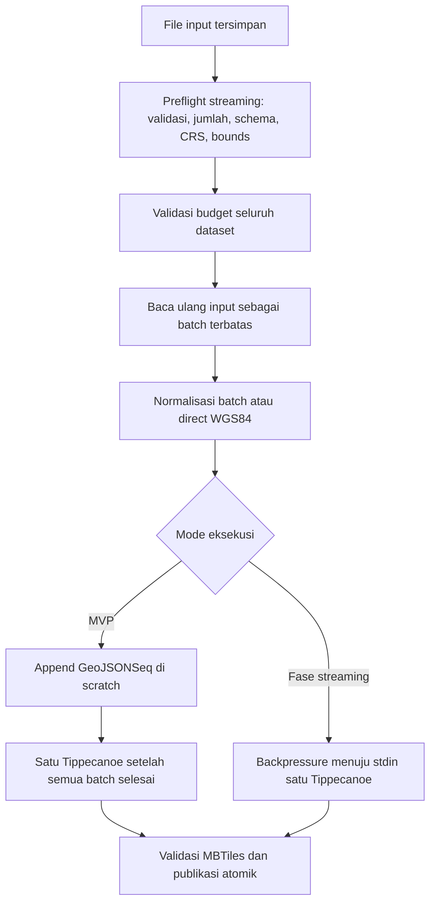

# TileO Vector Batching — Design and Implementation Notes

Status: tahap 1–4 diimplementasikan; audit tahap 0–3 dan gate produksi tercatat di [BATCH_SYSTEM_AUDIT.md](BATCH_SYSTEM_AUDIT.md).  
Tanggal pemeriksaan kode: 15 Oktober 2026.

## 1. Tujuan dan keputusan utama

Memproses input vector besar secara bertahap agar pembacaan, inspeksi, dan normalisasi tidak perlu menampung seluruh dataset di RAM. Satu job tetap menghasilkan satu MBTiles melalui satu proses Tippecanoe yang menerima seluruh feature.

Implementasi dilakukan dalam dua bentuk yang berurutan:

1. **Batch dengan intermediate di disk:** pecah pembacaan dan normalisasi menjadi bagian terbatas, gabungkan hasil normalisasi sebagai GeoJSONSeq, lalu jalankan Tippecanoe sekali. Ini menjadi MVP dan jalur pembanding yang mudah diverifikasi.
2. **Batch dengan streaming ke Tippecanoe:** kirim hasil normalisasi tiap batch ke stdin satu proses Tippecanoe, kemudian hapus file batch yang selesai dikirim. Ini mengurangi intermediate GeoJSONSeq penuh setelah pengelolaan proses dan resource siap.

Batching tidak menjamin semua file yang lolos upload akan berhasil dikonversi. Satu geometri sangat besar, kebutuhan internal Tippecanoe, luas cakupan, dan rentang zoom tetap dapat melampaui resource.

## 2. Cakupan

Prioritas pertama adalah `.geojson` dan `.json` berisi GeoJSON FeatureCollection, termasuk file yang seluruh isinya berada dalam satu baris. Tambahkan dukungan eksplisit `.geojsonl` pada validasi API dan UI jika format ini dibuka untuk upload; saat ini helper vector mengenal ekstensi tersebut, tetapi allowlist upload belum menerimanya.

CRS WGS84 yang terverifikasi dapat melewati normalisasi GDAL. GeoJSON dengan CRS lain menggunakan normalisasi per batch setelah CRS ditentukan dan divalidasi. Format GeoPackage, FlatGeobuf, ZIP Shapefile, dan KML tetap memakai adapter lama sampai masing-masing lolos pengujian pembacaan bertahap.

Fase ini tidak mencakup upload resumable, batch upload banyak file, raster yang dipecah menjadi beberapa job, GLB, atau banyak worker sekaligus. Worker tetap menjalankan satu job aktif; batching berlangsung di dalam job tersebut.

## 3. Kondisi kode yang menjadi dasar

| Komponen | Perilaku saat ini | Implikasi terhadap batching |
| --- | --- | --- |
| `Inspeksi` (reference path: `src/inspect.ts`) | Vector diperiksa dengan `ogrinfo -json -so -al` | Perbaikan harus menjangkau inspeksi; membagi data setelah inspeksi tidak mengatasi masalah yang terjadi saat membuka sumber |
| `Endpoint inspeksi` (reference path: `src/api.ts`) | `/api/inspect` memanggil inspeksi sebelum enqueue | Jalur API dan worker harus memakai pembacaan yang konsisten |
| `Normalisasi vector` (reference path: `src/vector.ts`) | Umumnya membuat `features.geojsonl` penuh melalui `ogr2ogr` | MVP tetap memakai file penuh ini; fase streaming menghilangkannya dari jalur yang didukung |
| `Runner` (reference path: `src/process.ts`) dan `guardian` (reference path: `src/tool-host.ts`) | stdin diabaikan; stdout/stderr diteruskan melalui IPC untuk log/capture | Data geometri memerlukan kanal streaming tersendiri dengan backpressure |
| `Worker` (reference path: `src/worker.ts`) | Satu job, satu deadline, pemeriksaan disk dan scratch | Semua batch berbagi budget dan deadline job |
| `Antrean` (reference path: `src/jobs.ts`) | Batas 20 mencakup `QUEUED` dan `RUNNING` | Batch bukan job antrean baru |

Batas yang tetap berlaku:

- Upload 16 GiB/file; scratch 32 GiB/job; cadangan disk 2 GiB; waktu job 7.200 detik; zoom 0–22.
- Estimasi `featureCount × (maxZoom - minZoom + 1)` maksimal 50 juta. Mengurangi atribut tidak mengubah hitungan ini; untuk lolos batas hitungan, kurangi feature atau rentang zoom.
- Batas estimasi tile 2 juta di max zoom saat ini juga dapat mengenai vector yang mempunyai bounds, karena pemeriksaan worker tidak dibatasi ke raster.
- Aturan Density/Preserve, pilihan atribut, serta batas tile tetap dihitung terhadap seluruh dataset.

Konfigurasi memori sudah diselaraskan pada tahap 0: fallback tool 4 GiB, hard limit worker Compose default 6 GiB. `.env` lokal mengatur tool 12 GiB dan container 14 GiB. Inspeksi API dibatasi maksimal 256 MiB secara terpisah dari budget worker. Runtime Docker tetap perlu diverifikasi pada deployment; konfigurasi file bukan hasil pengukuran container.

## 4. Alur yang direncanakan

Dua lintasan pembacaan disengaja: lintasan pertama menentukan statistik dan kebijakan seluruh dataset; lintasan kedua mengirim feature dengan kebijakan yang sudah tetap. Ini mempertahankan keputusan density tier, preserve floor, pemilihan atribut, dan batas feature-copy sebelum tiling dimulai.

### 4.1 Preflight sebelum GDAL membuka GeoJSON besar

- Gunakan parser JSON incremental yang mendukung FeatureCollection tanpa bergantung pada pemisah baris. Pemilihan dependensi dilakukan pada spike dan dipin dalam lockfile.
- Jangan memakai `readFile + JSON.parse` untuk seluruh dokumen, regex pemisah JSON, atau satu array berisi semua feature.
- Batasi byte feature, ukuran token/string, kedalaman JSON, dan buffer sebelum membentuk object JavaScript. Batas setelah `JSON.parse` sudah terlambat untuk input yang terlalu besar.
- Kumpulkan jumlah feature, jenis geometri, daftar atribut beserta jenisnya, dan extent. Periksa struktur dokumen sampai EOF; JSON terpotong atau rusak pada bagian akhir harus menggagalkan job.
- Identifikasi CRS dari metadata yang dapat dibuktikan atau `sourceCrs`. Jangan menebak WGS84 hanya karena koordinat terlihat seperti longitude/latitude. Format/CRS yang tidak dapat dibuktikan harus mengikuti validasi lama atau menghasilkan error yang jelas.
- Untuk reproyeksi, perhitungan bounds WGS84 harus memakai transformasi yang tervalidasi; jika tidak tersedia, nyatakan bounds tidak diketahui dan gunakan aturan fallback yang sudah ada.
- Hindari schema yang berubah mengikuti batch. Tentukan schema global lebih dahulu, termasuk atribut yang baru muncul pada feature terakhir dan benturan `id`/`id2`.
- Daftar atribut untuk validasi internal tidak boleh terpotong mengikuti batas 100 field tampilan saat ini. Jika schema melebihi budget metadata, gagal secara eksplisit atau gunakan penyimpanan schema di disk.
- Jalankan pembaca di proses terawasi supaya API/worker tetap responsif untuk heartbeat, cancel, dan deadline. Endpoint inspeksi API memiliki budget tersendiri yang sesuai hard limit container API 512 MiB.
- Metadata hasil inspeksi boleh dipakai ulang bila hash input dan opsi yang memengaruhi inspeksi masih cocok. Pemeriksaan CRS, layer, atau filter harus diulang jika opsi berubah.

### 4.2 Pembentukan dan normalisasi batch

- Tutup batch ketika mencapai batas jumlah feature atau byte, mana yang tercapai lebih dahulu.
- Satu feature utuh berada dalam satu batch. Feature yang melampaui batas satu feature menghasilkan `FEATURE_TOO_LARGE` dengan nomor feature dan ukuran; jangan memotong geometri atau melewatinya diam-diam.
- Tulis batch langsung ke file sementara, dengan buffer terbatas. Selesaikan dan rename file sebelum tool membacanya.
- Jalankan maksimal satu normalisasi GDAL sekaligus pada MVP. Hindari `Promise.all` atas seluruh batch atau pagination SQL `OFFSET` berulang yang dapat memindai sumber berkali-kali.
- Pertahankan normalisasi sekarang: EPSG:4326, koordinat 2D, `RS=NO`, precision 9, dan `AUTODETECT_JSON_STRINGS=NO` ketika memakai GDAL.
- Terapkan schema global pada normalisasi agar atribut campuran tidak berubah jenis antarbatch. Pembuktian kompatibilitas schema menjadi syarat aktivasi adapter GDAL per batch.
- Pertahankan `properties.id`, `ID`, `id2`, dan feature ID sesuai semantik jalur lama. FID yang dibuat ulang dari nol setiap batch tidak boleh menjadi ID output yang duplikat.
- Parser/serializer tidak boleh mengubah integer besar atau string berkode seperti `"00123"`. Gunakan representasi/token yang menjaga nilai dan verifikasi dengan fixture.
- Direct WGS84 hanya diaktifkan setelah tipe atribut, koordinat, filter, dan hasil tile lolos uji kesetaraan. Jika memakai aturan direct lama, pertahankan seluruh kondisi pemeriksaannya.

### 4.3 MVP: intermediate di disk

- Append hasil normalisasi sesuai urutan sumber ke satu GeoJSONSeq; jangan menyimpan semua batch dalam RAM.
- Hapus input dan output sementara batch setelah append selesai. Pertahankan file sumber asli untuk retry.
- Setelah seluruh input valid dan seluruh batch selesai, tutup intermediate lalu panggil Tippecanoe satu kali dengan seluruh file.
- MVP masih membutuhkan ruang untuk GeoJSONSeq penuh, temporary file Tippecanoe, dan output MBTiles. Jangan menyatakan MVP sudah menghilangkan kebutuhan scratch yang sebanding ukuran dataset.

### 4.4 Fase streaming: satu Tippecanoe sepanjang pengiriman

Tippecanoe mendukung input GeoJSON melalui stdin ketika tidak diberi file input. Setiap feature dapat dikirim sebagai satu baris; gunakan layer output yang tetap, yaitu `features`. Lihat [dokumentasi input Tippecanoe](https://github.com/felt/tippecanoe#usage).

- Tambahkan runner yang membuka stdin tool dan menunggu `drain` ketika consumer melambat. File/stream geometry tidak boleh lewat jalur `capture`, string IPC, atau log stdout yang dibatasi sekitar 8 MiB.
- Guardian memiliki seluruh proses pipeline. Hilangnya koneksi worker, cancel, timeout, atau kegagalan satu proses harus menghentikan producer dan consumer beserta turunannya.
- Producer mengirim satu batch selesai normalisasi, lalu membersihkannya sebelum melanjutkan batch berikutnya. Prefetch dinonaktifkan pada versi pertama.
- Tutup stdin hanya setelah seluruh batch berhasil dikirim. Berakhirnya stdin bukan tanda job selesai: tunggu exit Tippecanoe, validasi output, dan pemeriksaan cancel sebelum publikasi.
- Panggil Tippecanoe tanpa `-P` pada streaming awal; benchmark opsi tersebut secara terpisah. Kode vendored `main.cpp` (reference path: `tippecanoe/main.cpp`) menunjukkan jalur stream dengan `-P` membuat temporary file pembacaan. Streaming tetap memerlukan temporary storage internal Tippecanoe.
- Jangan membuat MBTiles per batch lalu menggabungkannya. Density, clustering, batas tile, dan shared geometry memerlukan konteks seluruh dataset; penggabungan tile terpisah tidak otomatis memberi hasil yang setara.
- GDAL fallback tetap boleh memakai intermediate penuh. `auto` hanya fallback ketika Tippecanoe tidak dapat dimulai dan preset Density; kegagalan setelah pemrosesan berjalan tetap error, bukan alasan mengulang diam-diam dengan engine lain.

## 5. Konfigurasi baru yang diusulkan

Angka berikut adalah titik awal benchmark, belum merupakan batas aplikasi yang berlaku.

| Variabel | Usulan awal | Perilaku |
| --- | --- | --- |
| `TILEO_VECTOR_BATCH_MODE` | `off` saat rollout | `off`, `auto`, atau `on`; `auto` memakai batch untuk format yang sudah lulus uji, `on` mewajibkan adapter batch dan menolak format vector yang belum didukung |
| `TILEO_VECTOR_BATCH_FEATURES` | `10000` | Maksimum feature dalam satu batch |
| `TILEO_VECTOR_BATCH_MB` | `16` | Maksimum byte input batch, di luar overhead wrapper yang juga harus dibatasi |
| `TILEO_VECTOR_MAX_FEATURE_MB` | `16` | Batas satu feature; tidak boleh melebihi batas byte batch |
| `TILEO_VECTOR_BATCH_DELIVERY` | `file` | `file` untuk MVP; `stream` setelah runner dan adapter lolos uji |

Variabel ukuran memakai MiB (`1024²`) agar konsisten dengan project. Batasi nilai konfigurasi saat startup; jangan menerima nol, negatif, bukan integer, atau kombinasi yang melampaui budget deployment. Konfigurasi ini perlu diteruskan secara eksplisit pada Compose dan didokumentasikan dalam `.env.example`.

Batas satu feature merupakan pembatas baru pada jalur batching. Tampilkan error yang menjelaskan batas aktual, bukan mengalihkan diam-diam ke jalur tanpa batching. GDAL sendiri mendokumentasikan `OGR_GEOJSON_MAX_OBJ_SIZE` dengan default 200 MB untuk satu feature; itu bukan batas total file. Bila opsi ini disetel per proses, selaraskan dengan budget pembaca dan jangan menonaktifkan batas dengan nilai `0`. Lihat [GDAL GeoJSON](https://gdal.org/en/stable/drivers/vector/geojson.html#configuration-options).

## 6. Resource, lifecycle, dan kegagalan

- **Memori:** pada streaming, parser, guardian, GDAL, dan Tippecanoe dapat hidup bersamaan. Ukur total proses yang dimiliki pipeline, bukan memberikan seluruh budget ke masing-masing proses. Native sampling tetap best effort; hard limit container mencakup keseluruhan proses.
- **CPU:** bagi budget thread antartool yang berjalan bersamaan. Dua thread per tool bukan berarti dua thread total ketika GDAL dan Tippecanoe aktif bersama.
- **Disk:** hitung batch aktif, intermediate, output sementara, dan scratch tool. Pemeriksaan ukuran direktori saat ini tidak melihat file yang sudah di-unlink tetapi masih terbuka; evaluasi accounting open-file/quota pada platform target dan tetap pantau free disk volume.
- **Timeout:** gunakan deadline absolut job. Tiap batch hanya mendapat sisa waktu; waktu dua jam tidak dimulai ulang pada setiap batch. Inspeksi sebelum enqueue memakai deadline terpisah yang juga dibatasi.
- **Cancel/error:** hentikan pembacaan dan semua tool, tunggu proses berhenti, tutup handle, kemudian hapus file parsial. Error producer harus tetap terlihat meski consumer akhirnya melaporkan broken pipe.
- **Retry:** MVP mengulang dari input asli dalam attempt baru. Batch yang pernah dikirim ke stdin tidak bisa langsung dilanjutkan setelah Tippecanoe mati.
- **Publikasi:** output hanya tersedia setelah semua batch selesai, exit tool berhasil, validasi MBTiles lulus, dan kepemilikan worker masih sah.
- **Status:** state publik tetap `QUEUED → RUNNING → SUCCEEDED / FAILED / CANCELLED`. Gunakan stage seperti preflight, normalisasi batch, tiling, validasi, dan publikasi.

Simpan ringkasan per attempt: mode, jumlah feature dibaca/dikirim, jumlah batch, byte input/normalisasi, durasi tiap tahap, peak memory, peak scratch, serta alasan jalur fallback. Tulis progres dengan frekuensi terbatas, misalnya satu kali per detik. Jika total belum diketahui, tampilkan hitungan berjalan dan hindari persentase atau ETA yang seolah-olah pasti.

## 7. Tahapan implementasi

### Tahap 0 — Baseline dan spike

- [x] Catat versi GDAL/Tippecanoe yang benar-benar dijalankan pada native dan Docker.
  - Native (WSL host): GDAL 3.12.2 "Chicoutimi", Tippecanoe v2.79.0.
  - Docker (`Dockerfile`): Node 24.x runtime (exact image subject to release validation), gdal-bin (Debian 13), Tippecanoe 2.79.0 (source build).
- [x] Ukur inspeksi, normalisasi, tiling, peak memory, dan peak scratch secara terpisah pada pipeline lama.
  - `ogrinfo -json -so -al` membaca seluruh struktur GeoJSON ke RAM (22.7 MB file butuh ~60 MB RSS; ~487 MB GeoJSON memuncak hingga ~5.5 GB private bytes).
  - Tiling baseline Tippecanoe 20k points: ~500 ms.
- [x] Bandingkan parser incremental untuk FeatureCollection satu baris, token besar, integer besar, dan malformed JSON.
  - Terverifikasi via `src/spike-parser.ts` & `src/tests/spike-parser.test.ts`: pemindaian streaming menjaga heap < 25 MB untuk puluhan ribu feature, menangani string escape berisikan kurung/kutip, menolak malformed JSON & feature oversized.
- [x] Buktikan input stdin, exit/error propagation, dan perbedaan performa stdin versus file pada Tippecanoe yang dipakai project.
  - Stdin Tippecanoe terbukti setara kecepatannya dengan file (507 ms stdin vs 517 ms file pada 20k dataset).
  - Exit code Tippecanoe terkonfirmasi: 101 (args), 110 (nodata/invalid geometries), 111 (open db fail). Tanpa `-P`, Tippecanoe tidak membuat temporary `read.XXXXXXXX` di scratch.
- [x] Selaraskan memori `.env`/Compose dengan hard limit container dan budget inspeksi API.
  - Fallback `TILEO_TOOL_MEMORY_MB` diselaraskan ke 4096 di `src/config.ts`, `compose.yaml`, dan `.env.example`.
  - Ditambahkan `TILEO_WORKER_MEM_LIMIT` di `compose.yaml` (default 6g) dan `.env` (14g bila tool budget 12288) agar guardian dapat menangani limit sebelum Docker OOM-kill.

### Tahap 1 — Preflight dan batching ke disk

- [x] Tambahkan modul `src/vector-reader.ts` untuk membaca dan memvalidasi feature secara incremental.
  - Implementasi parser streaming incremental (`scanGeoJsonFeatures`, `scanGeoJsonlFeatures`, `scanVectorFeatures`). Menolak feature melebihi batas byte (`FEATURE_TOO_LARGE`) dan mendeteksi GeoJSON terpotong/malformed (`MALFORMED_JSON`).
  - Pass 1 streaming (`preflightGeoJson`): mengumpulkan `featureCount`, `fields` (global schema tanpa terpotong), `geometryType`, `bounds`, `crs`/`epsg`, serta flag `hasId`/`hasId2`.
  - Pass 2 streaming (`readGeoJsonBatches`): partisi feature ke dalam batch berdasarkan batas jumlah feature (`batchFeatures`) dan byte size (`batchBytes`).
- [x] Tambahkan `src/vector-batch.ts` untuk batch, normalisasi, append, dan cleanup.
  - Mode `direct` (WGS84 GeoJSON): menulis feature langsung ke GeoJSONSeq scratch (`features.geojsonl`) dengan filtering atribut `includeProperties` streaming tanpa overhead GDAL.
  - Mode `ogr` (non-WGS84 / reprojection): membagi ke scratch GeoJSON per batch, memanggil `ogr2ogr` per batch ke GeoJSONSeq intermediate, merestore `id2` -> `id` bila diperlukan, mengindeks sequential FID global per batch untuk mencegah ID duplikat, dan menghapus batch sementara segera setelah di-append.
- [x] Integrasikan preflight ke `src/inspect.ts` untuk jalur API maupun worker sebelum pemanggilan inspeksi GDAL atas GeoJSON besar.
  - Menjalankan `preflightGeoJson` ketika `vectorBatchMode !== 'off'` untuk file `.geojson`, `.json`, `.geojsonl`. Menyediakan `allFields` lengkap pada `Inspection` dan melempar `UNSUPPORTED_INPUT` pada mode strictly `on` jika format non-GeoJSON diberikan.
- [x] Pertahankan statistik global dan pemeriksaan budget dalam `src/worker.ts`.
  - Validasi atribut `includeProperties` mengecek skema lengkap `allFields ?? fields`.
- [x] Tambahkan konfigurasi di `src/config.ts`, `.env.example`, serta `compose.yaml`.
  - `TILEO_VECTOR_BATCH_MODE` (`off` | `auto` | `on`, default `off`).
  - `TILEO_VECTOR_BATCH_FEATURES` (default 10000).
  - `TILEO_VECTOR_BATCH_MB` (default 16).
  - `TILEO_VECTOR_MAX_FEATURE_MB` (default 16).
  - `TILEO_VECTOR_BATCH_DELIVERY` (`file` | `stream`, default `file`).
- [x] Aktifkan satu adapter GeoJSON terlebih dahulu; fallback format lain harus tercatat.
  - Format `.geojson`, `.json`, dan `.geojsonl` didukung via streaming batch adapter.
- [x] Uji kesetaraan hasil dan pengurangan peak RAM sebelum beralih ke tahap streaming.
  - Pengujian unit diuji via `src/tests/vector-batch.test.ts` (50 test suite passed di `npm test`).

### Tahap 2 — Runner streaming dan resource gabungan

- [x] Perluas `src/process.ts` dan `src/tool-host.ts`, atau tambahkan runner khusus, dengan kanal data ber-backpressure yang terpisah dari IPC metadata.
  - Runner khusus baru `src/pipeline.ts` (`runWithStdin` + `writeLine`): geometri mengalir hanya lewat pipe stdin dengan `drain` backpressure; stdout/stderr mengalir lewat kanal metadata log/tail (tak pernah `capture` geometri). Stdin ditutup hanya setelah semua batch terkirim; EOF bukan tanda selesai — exit tool, validasi, dan pemeriksaan cancel tetap menentukan hasil.
  - `src/tool-host.ts` memakai agregasi memori process-tree (RSS anak + turunan via satu snapshot `ps`, PrivateMemorySize64 agregat di Windows) dengan anggaran bersama, bukan satu budget per proses.
- [x] Tambahkan agregasi penggunaan memori dan penghentian semua proses pipeline di `src/resources.ts`/guardian.
  - `src/resources.ts`: `killProcessTree` (grup proses POSIX / `taskkill /T` Windows) dan `processTreeMemoryBytes` (agregat RSS tree, best-effort; hard limit container tetap batas final). Dipakai `pipeline.ts` (interval 3 dtk, budget `config.memoryBytes`) dan logika setara di guardian.
- [x] Tangani consumer lambat, stdin putus, producer error, timeout, dan worker disconnect tanpa deadlock atau proses tertinggal.
  - Producer error tetap terlihat meski consumer ikut melaporkan broken pipe; `TOOL_MISSING`/`CANCELLED`/`TIMEOUT`/`MEMORY_LIMIT` menang atas EPIPE sekunder. Abort/timeout membunuh tree (`SIGTERM`, lalu `SIGKILL` saat cleanup), menghancurkan stdin agar producer yang menunggu `drain` tidak deadlock. `events.once(proc,'close')` tidak dipakai karena menolak dengan ENOENT mentah — close-promise manual menjaga klasifikasi `TOOL_MISSING` untuk fallback Density. Tanpa prefetch: satu batch dinormalisasi–dikirim–dibersihkan sebelum batch berikutnya.
- [x] Integrasikan `file`/`stream` ke `src/vector.ts`; satu invokasi Tippecanoe per attempt yang berhasil.
  - `tippecanoeStreamArgs` (tanpa `-P`, tanpa operand file; stdin satu-satunya input) dan cabang streaming di `runTippecanoe` bila `useBatch && vectorBatchDelivery === 'stream' && engine !== 'gdal'`. Produser `streamVectorBatches` (`src/vector-batch.ts`): mode direct filter atribut streaming, mode ogr (`ogr2ogr` per batch + restore `id2`→`id` + FID global sekuensial + cleanup langsung). Fallback GDAL hanya untuk `TOOL_MISSING` + preset Density; kegagalan tengah-aliran tetap error.
  - Pengujian unit `src/tests/vector-stream.test.ts` (12 test): args stream, backpressure 20k baris, error producer vs consumer, `TOOL_MISSING`, abort, `writeLine` pada consumer mati, filter atribut + tanpa intermediate, `MALFORMED_JSON`/`FEATURE_TOO_LARGE`, helper resources. `npm test`: 62 lulus, 0 gagal, 8 skip (integration).
- [x] Pastikan temporary file dan output staged berada di scratch job, bukan tmpfs `/tmp` Docker yang hanya 128 MiB.
  - `--temporary-directory <scratch>` dipertahankan di args stream; batch temp (`batch-*.geojson[l]`) dan output staged (`result.mbtiles`) di scratch job; runner tidak membuat temp file sendiri.

### Tahap 3 — Observabilitas dan rollout

- [x] Tambahkan ringkasan batch ke metadata job dan tampilkan progres di `src/web/app.ts`.
  - `vector()` mengembalikan `VectorBatchSummary` (policy snapshot, `active`/`stream`/`normalization`, `featureCount`, `batchCount`, `bytesNormalized`, `fallback`, `normalizeMs`/`tileMs`, `peakMemoryBytes` guardian); worker melampirkan sebagai `metadata.batch` plus `peakScratchBytes` dari sampling scratch 2 dtk. Byte hasil (`bytesWritten` file / `bytesSent` stream) dan throttle progres ~1 Hz + flush final di `src/vector-batch.ts`; peak memori pipeline di `src/pipeline.ts`.
  - UI: baris hasil job menampilkan `batch file|stream … · N features · M batches` (atau `fallback …`); teks `stage` yang mengalir (`Vector: streamed batch 3/15 …`) tetap tampil saat RUNNING via polling 2,5 dtk. Browser spec hanya screenshot (tanpa asersi teks hasil), jadi aman; e2e browser tidak dijalankan di sini.
- [x] Perbarui `API.md`, `openapi.yaml` bila respons berubah, `OPERATIONS.md`, dan `TYPESCRIPT_ARCHITECTURE.md`.
  - `API.md`: bentuk `metadata.batch`, string progres, dan variabel `TILEO_VECTOR_BATCH_*`. `openapi.yaml`: skema `Job.metadata.batch` (sebelumnya `metadata` tak terdokumentasi). `OPERATIONS.md`: baris env + seksi rollout/rollback/benchmark. `TYPESCRIPT_ARCHITECTURE.md`: modul `pipeline.ts`/`vector-batch.ts`/`vector-reader.ts`, ringkasan batch, dan paragraf pipeline native.
- [x] Rilis dengan mode `off`; uji `on` secara eksplisit pada dataset benchmark.
  - Default tetap `off` (`src/config.ts`, `compose.yaml`). Uji eksplisit 150k poin / 23 MB single-line GeoJSON, z0–5 density, GDAL 3.12.2 + Tippecanoe 2.79.0 (WSL Ubuntu): `off` 3,3 dtk/74 MB; `on`+`file` 6,6 dtk/222 MB (15 batch, 22,2 MB ternormalisasi); `on`+`stream` 6,5 dtk/216 MB (tanpa intermediate, peak guardian 41 MB best-effort). Overhead vs legacy adalah 15× `ogr2ogr` per-batch (dataset ini tanpa properti `id` sehingga jalur direct tidak berlaku). Decode tile z5 identik (629 feature, atribut sama); output `file`/`stream` sama besar. Dataset 500 MiB dan perbandingan mode direct masih terbuka.
- [x] Aktifkan `auto` untuk adapter yang memenuhi kriteria penerimaan; simpan mode `file` sebagai pilihan pembanding.
  - Adapter `.geojson`/`.json`/`.geojsonl` lolos unit + benchmark kesetaraan di atas; `auto` didokumentasikan sebagai langkah rollout, `file` tetap baseline pembanding. Default produksi tidak dibalik ke `auto` dalam tahap ini (keputusan rilis; laporan benchmark lengkap 500 MiB dulu per kriteria 8).
- [x] Rollback konfigurasi memakai `off` untuk job berikutnya; jangan mengganti mode di tengah attempt.
  - Worker membekukan `batchMode`/`batchDelivery` per attempt ke `RunOptions`; `inspect()` dan `vector()` memakai snapshot, bukan config live. Rollback = `off` + restart, berlaku untuk job berikutnya. Tercakup unit test `snapshotBatchConfig`.

### Tahap 4 — Perluasan adapter

- [x] Uji GPKG, FGB, ZIP Shapefile, dan KML satu per satu; ukur apakah driver membaca sumber secara incremental atau menahan banyak data saat membuka dataset.
  - Benchmark 5k/50k feature: RSS reader GPKG/FGB/ZIP Shapefile sekitar 59–65 MiB; LIBKML meningkat dari sekitar 72–76 menjadi 237–238 MiB. KML tetap legacy pada `auto` dan ditolak pada `on`.
  - Bukti native GDAL 3.12.2/Tippecanoe 2.79.0, metodologi, batas platform, serta hasil GeoJSON 516,52 MiB ada di [laporan audit](BATCH_SYSTEM_AUDIT.md).
- [x] Untuk driver yang sesuai, gunakan satu pembacaan sequential GDAL menuju GeoJSONSeq; membatasi output stream tidak otomatis membatasi memori reader GDAL.
  - `src/vector-adapter.ts`: verifikasi driver aktual, selected layer, satu invokasi OGR, stdout melalui kanal khusus, record bounded, dan backpressure. `file` dan `stream` memakai normalisasi yang sama, dengan satu Tippecanoe untuk semua batch.
  - `src/tests/vector-adapter.test.ts`: adapter, multilayer, jumlah invokasi, kesetaraan hasil file/stream, ID/properti, reproyeksi dan fallback KML.
- [x] Evaluasi checkpoint normalisasi sebagai fitur lanjutan yang terpisah. Resume akan memerlukan perubahan cleanup scratch dan validasi hash/schema/opsi antarattempt.
  - Keputusan: retry tetap dari input asli; resume persisten belum diaktifkan. Kontrak manifest, validasi identitas, retensi, dan batas resume Tippecanoe didokumentasikan pada laporan audit.

### Hasil audit tahap 0–3

Checklist dan benchmark historis di atas merekam pekerjaan sebelum audit, bukan penerimaan produksi menyeluruh. Audit memperbaiki parser/CRS, presisi token atribut dan ID, isolasi preflight, guardian streaming, resource pipeline, deadline absolut, error cleanup, serta timing metadata. Hasil akhir dan gate yang masih terbuka dijelaskan di [BATCH_SYSTEM_AUDIT.md](BATCH_SYSTEM_AUDIT.md). Default batch tetap `off`.

## 8. Pengujian dan kriteria penerimaan

| Area | Kasus yang harus diuji | Kriteria |
| --- | --- | --- |
| Parser | FeatureCollection satu baris/berformat, UTF-8 terbelah antarbuffer, string escape, dokumen rusak di akhir | Feature lengkap dan valid, kegagalan jelas, tanpa membaca seluruh dokumen ke RAM |
| Batas batch | Tepat di batas byte/jumlah, satu feature terlalu besar, token/depth berlebihan | Batas ditegakkan sebelum alokasi tidak terkendali; feature tidak terpotong |
| Atribut/ID | `id`, `ID`, `id2`, atribut baru di batch terakhir, null, tipe campuran, integer besar, kode string | Tidak ada perubahan nilai/nama atau ID duplikat akibat pembagian batch |
| Geometri/CRS | Point, line, polygon, multi-geometry, null geometry, WGS84 dan CRS reproyeksi | Semantik sesuai jalur lama; no-data/unsupported geometry dilaporkan, tidak disembunyikan |
| Density/Preserve | Dataset kecil/padat, minZoom rendah, batas tile eksplisit | Kebijakan dihitung untuk seluruh dataset; thinning yang disengaja dibedakan dari kehilangan akibat batching |
| Lifecycle | Cancel saat preflight/normalisasi/tiling, timeout, crash worker, consumer berhenti | Tidak ada orphan process, deadlock, atau output parsial yang terpublikasi |
| Resource | Producer cepat/consumer lambat, disk penuh, memori mendekati budget | Buffer terbatas, producer menunggu, error resource konsisten |
| Fallback | Tippecanoe hilang, gagal setelah mulai, engine GDAL, Preserve | Hanya kondisi fallback yang diizinkan menjalankan GDAL |
| API | `/api/inspect`, upload langsung, `inspectionId`, opsi CRS/filter berubah | Hasil inspeksi konsisten; tidak ada jalur yang kembali membuka GeoJSON besar tanpa kebijakan yang dipilih |

Benchmark minimal memakai data kecil, dataset representatif sekitar 500 MiB, dan dataset lebih besar bila fixture/storage tersedia. Gunakan dataset dasar yang sama pada beberapa skala untuk melihat apakah memori pembacaan bertambah seiring ukuran total. Satu feature kompleks perlu fixture tersendiri.

Bandingkan pipeline lama, batch/file, dan batch/stream dengan input, versi tool, zoom, preset, thread, serta media disk yang sama. Catat waktu total dan per tahap, peak RSS/private bytes, penggunaan container, peak scratch, ukuran output, jumlah tile, dan hasil decode tile.

Syarat selesai:

1. Semua feature yang valid mencapai normalisasi/tiling sesuai kontrak; tidak ada feature hilang atau ganda akibat batas batch.
2. Pada fixture Preserve, hasil decode geometri/atribut setara secara semantik dalam aturan clipping dan kuantisasi yang sama. Jumlah feature tile tidak harus sama dengan jumlah feature sumber karena satu feature bisa melintasi banyak tile.
3. Pada Density, perbedaan thinning/cluster diukur dan dijelaskan; tidak mengharuskan hash MBTiles identik atau menjanjikan semua feature tetap tampil.
4. Memori pembaca/normalisasi terbukti terkendali oleh ukuran batch/feature pada uji skala. Peak keseluruhan Tippecanoe tetap diukur secara terpisah dan tidak diklaim konstan.
5. Jalur streaming tidak menghasilkan intermediate GeoJSONSeq seluruh dataset; penggunaan temporary storage internal tool tetap dicatat.
6. Cancel, timeout, crash, dan disk penuh tidak mempublikasikan output parsial dan tidak meninggalkan tool berjalan.
7. Lulus typecheck/build, pengujian batch/runner yang relevan, dan integration test GDAL/Tippecanoe nyata. Suite project dapat dijalankan dengan `npm test`; integration test yang sudah ada memakai `TILEO_INTEGRATION=1`. Browser test diperlukan saat progres UI berubah.
8. Mode `auto` hanya diaktifkan setelah laporan benchmark mencantumkan manfaat, biaya waktu tambahan, dan platform yang telah diuji.

## 9. Rujukan teknis

- [GDAL GeoJSONSeq](https://gdal.org/en/stable/drivers/vector/geojsonseq.html): format feature per record, opsi `RS`, precision, dan batas satu object.
- [Tippecanoe: parallel processing of input](https://github.com/felt/tippecanoe#parallel-processing-of-input): persyaratan newline per feature dan perbedaan karakteristik file versus stream.
- `Source Tippecanoe yang disertakan project` (reference path: `tippecanoe/main.cpp`): verifikasi perilaku temporary file pada input stream; cocokkan lagi dengan binary deployment ketika implementasi dimulai.

Penggunaan pipe saja tidak menjamin GDAL memakai RAM kecil: driver dapat mengalokasikan memori ketika membuka atau menginspeksi sumber. Karena itu, preflight dan pembacaan incremental sebelum normalisasi merupakan bagian wajib dari rencana ini.

> These dated engineering notes document the stated implementation and test observations at the time of writing. They are not certification of every current platform or release image. For current installation and test steps see [Installation](INSTALLATION.md), [Testing](TESTING.md), and [Release Process](RELEASE_PROCESS.md).
